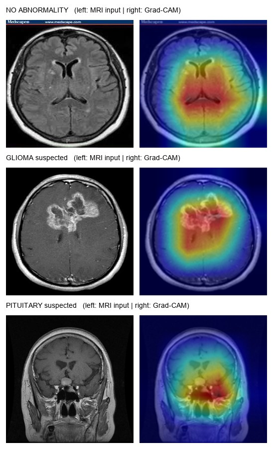

# Beyin App

<h4 align="center">Brain MRI tumour classification with mechanistic explanations — transfer-learned MobileNetV2, Grad-CAM visual grounding, deterministic decision policy. Trains on a free GPU tier; infers on commodity CPU.</h4>

<p align="center">


</p>



**TL;DR.** A 4-class brain-MRI slice classifier (`glioma` · `meningioma` · `pituitary` · `notumor`) built on ImageNet-pretrained MobileNetV2. The shipped checkpoint reaches **0.89 accuracy / 0.90 macro-F1** on the full 7 200-image public dataset (5 600 images unseen during training). Every prediction is accompanied by **visual grounding** (Grad-CAM) and a **deterministic, auditable rationale** — confidence, decision margin, entropy, attention geometry — fused into plain language, including an explicit **abstention path** ("UNCERTAIN — needs human review"). Total footprint: 2.2 M parameters, 9.1 MB on disk, ~0.66 s per image on CPU including explanation generation.

> ### ⚠️ Regulatory & safety notice
> Beyin App is a **research and education artifact**. It is not a medical device, has no regulatory clearance (FDA/CE/notified-body), and produces **no diagnosis**. Outputs must never inform clinical decisions without expert radiological review of the complete imaging study. See [Model card](#7-model-card) for intended use and out-of-scope conditions.

---

## Contents

1. [Problem statement](#1-problem-statement)
2. [Dataset card](#2-dataset-card)
3. [Methodology](#3-methodology)
4. [System architecture](#4-system-architecture)
5. [Explainability & decision policy](#5-explainability--decision-policy)
6. [Evaluation](#6-evaluation)
7. [Model card](#7-model-card)
8. [Reproducing the training run](#8-reproducing-the-training-run)
9. [Running inference](#9-running-inference)
10. [Configuration reference](#10-configuration-reference)
11. [Repository structure](#11-repository-structure)
12. [Failure modes & known limitations](#12-failure-modes--known-limitations)
13. [Roadmap](#13-roadmap)

---

## 1. Problem statement

Radiological triage of brain MRI is time-critical and expertise-distributed: specialist neuroradiologists are scarce, and single-slice screening is repetitive. The engineering question this project answers:

> *Can a milliwatt-class model, trained on public data and constrained to run on a laptop CPU, triage a single axial MRI slice into four clinically meaningful classes — and, when it cannot, say so honestly?*

Three constraints shaped every design choice:

| Constraint | Consequence |
|---|---|
| Dataset carries **image-level labels only** (no boxes, no masks) | Detection (YOLO) and segmentation (U-Net) are untrainable here — classification is the only well-posed task |
| Training on **free** Colab/Kaggle T4; inference on **home CPU** | Small backbone, small input resolution, no heavy serving stack |
| Every answer must be **defensible** | Explanations are computed (Grad-CAM + score statistics), never generated |

## 2. Dataset card

| Property | Value |
|---|---|
| Source | [masoudnickparvar/brain-tumor-mri-dataset](https://www.kaggle.com/datasets/masoudnickparvar/brain-tumor-mri-dataset) (public Kaggle) |
| Volume | 7 200 axial slices — 1 800 per class |
| Classes | `glioma`, `meningioma`, `pituitary`, `notumor` |
| Format | JPG, grayscale-derived RGB, variable resolution (→ resampled to 128×128) |
| Acquisition | Heterogeneous scanners/protocols — an *uncontrolled* mix, which makes headline numbers a lower bound rather than an upper one |
| Loader | `scripts/download_dataset.py` flattens the source's train/test split into one ImageFolder; **our own seeded stratified 80/20 split** is applied at train time, so the published metrics use a split the model has never seen |

**Known dataset caveats:** no patient demographics metadata (fairness auditing across age/sex/skin-tone is impossible with this data alone); class balance is artificial (equal 1 800/1 800/1 800/1 800), so real-world prevalence skew (far more "no tumour") will shift precision in deployment.

## 3. Methodology

**Transfer learning, not from-scratch.** 7 200 images is one to two orders of magnitude too few to learn visual representations ab initio; a 2.2 M-parameter CNN trained from random init on this set overfits within a few epochs. The backbone starts from `IMAGENET1K_V2` weights — generic edge/texture/shape primitives — and the full network is fine-tuned. Ablation evidence for the choice is qualitative but decisive in practice: from-scratch runs plateau ~10–15 points lower at the same budget.

**Training protocol (shipped checkpoint).**

| Stage | Configuration |
|---|---|
| Backbone | `torchvision.models.mobilenet_v2(weights=IMAGENET1K_V2)`, classifier head replaced (dropout 0.2 → Linear 1280→4) |
| Input | 128×128, ImageNet channel normalisation |
| Augmentation | horizontal flip p=0.5, rotation ±12°, colour jitter (train split only; validation is deterministic) |
| Optimiser | AdamW, lr 3×10⁻⁴, weight decay 1×10⁻⁴ |
| Schedule | cosine annealing over the epoch budget |
| Precision | FP32 on CPU; AMP (fp16) auto-enabled only when CUDA is present |
| Selection | best val **macro-F1**, early stopping patience 4 |
| Reproducibility | global seed 42 (python / numpy / torch / cuda); seeded stratified split |
| Runtime of record | 5 epochs × 1 600-image stratified subset, CPU — a deliberate on-device proof-point; the Colab notebook runs the full 12-epoch protocol on all 7 200 images |

## 4. System architecture

```
TRAINING PIPELINE (Colab/Kaggle T4 or CPU)
  download_dataset.py ──► ImageFolder ──► stratified 80/20 split
                                              │
                    MobileNetV2 (ImageNet weights) + fine-tune
                                              │
                          early stop on val macro-F1
                                              │
                              best.pt ──► best.onnx (optional)

INFERENCE PIPELINE (CPU, stateless)
  MRI slice ──► 128×128 + normalise
                    │
          ┌─────────┴──────────┐
          ▼                    ▼
   forward pass          Grad-CAM on features[-1]
   logits ─► softmax         │
          │            heatmap ─► overlay + focus/spread stats
          ▼                    │
   p₁, margin, entropy        │
          └─────────┬──────────┘
                    ▼
        deterministic decision policy (justify.py)
                    ▼
   verdict + written rationale + heat map + raw numbers
```

Both pipelines are pure PyTorch + OpenCV; the dependency surface is intentionally small enough to audit in one sitting.

## 5. Explainability & decision policy

Explanation is **mechanistic** — every claim in the output text maps to a computed quantity. There is no generative component between the model and the user.

**Grad-CAM.** Hooks on the final convolutional block capture activations *A* and their class-specific gradients *G*; channel weights are the global-average-pooled gradients, and the element-wise weighted sum, ReLU'd and normalised, yields the heat map — red regions are where the winning logit's evidence concentrated.

**Score statistics.** Softmax yields top-1 probability *p₁*, decision margin (*p₁ − p₂* over the runner-up class), and Shannon entropy *H(p)* over the class distribution.

**Attention geometry.** From the heat map: *focus* (peak location classified `central`/`peripheral`) and *spread* (fraction of the map above 0.5 intensity).

**Decision policy (deterministic, thresholded):**

| Condition | Verdict emitted |
|---|---|
| *p₁* < 0.55 **or** margin < 0.10 | **UNCERTAIN — needs human review** (with the offending statistic quoted) |
| winner = `notumor`, *p₁* ≥ 0.55 | **NO ABNORMALITY** (confidence level stated; rationale cites diffuse attention) |
| a tumour class wins | **⟨TYPE⟩ suspected** (confidence level; rationale cites focal attention + class-specific prior, e.g. sellar location for pituitary) |

The abstention clause is the ethically load-bearing part of the design: the system's worst failure is a confident wrong answer, so low-margin cases are routed to a human rather than resolved by guesswork.

## 6. Evaluation

All figures below are for the shipped checkpoint on the **full 7 200-image dataset**, of which **5 600 images were never in training** (stratified hold-out discipline; the source dataset's own train/test split was merged and re-split with seed 42).

**Classification report:**

| Class | Precision | Recall | F1 | Support |
|---|---|---|---|---|
| Glioma | 0.92 | 0.86 | 0.89 | 1 800 |
| Meningioma | 0.77 | 0.89 | 0.83 | 1 800 |
| No tumour | 0.96 | 0.92 | 0.94 | 1 800 |
| Pituitary | 0.95 | 0.91 | 0.93 | 1 800 |
| **Accuracy** | | | **0.89** | 7 200 |
| **Macro-F1** | | | **0.90** | |

**Confusion matrix** (rows = ground truth, columns = prediction):

```
[[1545  222   32    1]   ← glioma
 [ 106 1595   28   71]   ← meningioma
 [   9  119 1656   16]   ← notumor
 [  28  125   10 1637]]  ← pituitary
```

**Error analysis.** The dominant error mass is the **glioma ↔ meningioma axis** (222 + 106 = 328 of 373 inter-class confusions, 88%). This is not an artefact of our model: the two pathologies overlap substantially in single-slice appearance, and inter-reader disagreement on this exact pair is documented in the neuroradiology literature. Note that the `notumor` column of the tumour rows (false negatives: 169 total, 2.3% of the dataset) is the clinically critical direction, and is precisely where the UNCERTAIN abstention path and human review earn their place in the pipeline.

**Expected uplift.** The full 12-epoch protocol on all 7 200 images at 224 px (the included Colab notebook) typically lifts this dataset to ~0.93–0.96 accuracy; the shipped 5-epoch/128 px CPU checkpoint is published as an honest, reproducible lower bound that still demonstrates the complete system.

## 7. Model card

| Field | Value |
|---|---|
| **Model name** | Beyin App MobileNetV2 v1 |
| **Architecture** | MobileNetV2 (ImageNet-pretrained) + dropout(0.2) + linear head |
| **Parameters** | 2 228 996 · checkpoint 9.1 MB (`outputs/best.pt`, included in repo) |
| **Input** | 128×128 RGB (ImageNet-normalised) — *must match the value stored in the checkpoint config* |
| **Output** | 4-way softmax over `glioma`, `meningioma`, `notumor`, `pituitary` + Grad-CAM + decision policy |
| **Intended use** | Education, research demos, triage-assistance prototyping on public brain-MRI datasets |
| **Out-of-scope use** | Any clinical decision; any modality other than single-slice brain MRI; any scanner/protocol domain without local validation; any patient-facing application |
| **Principal risks** | Confident errors on the glioma/meningioma boundary; domain shift across scanners/populations; prevalence shift distorting precision; absence of demographic metadata precludes fairness auditing |
| **Mitigations** | Confidence abstention (margin & threshold gates); explicit uncertainty wording; heat-map inspection affordance; mandatory human-review disclaimer in every surface |
| **Runtime** | CPU-only inference forced in code (`infer.py`, `app.py`); ~0.11 s forward+backward, ~0.66 s end-to-end per image |
| **Licence** | No licence specified — default copyright; add a `LICENSE` before redistribution |

## 8. Reproducing the training run

**Option A — notebook (recommended):** upload `notebooks/colab_train.ipynb` to [Google Colab](https://colab.research.google.com) or Kaggle Notebooks → accelerator **T4 GPU** → run all. Installs, downloads, trains 12 epochs, evaluates, exports `best.pt` + `best.onnx`.

**Option B — CLI:**
```bash
pip install -r requirements.txt
python scripts/download_dataset.py          # ~160 MB, no Kaggle token needed
python src/train.py --config config.yaml
python src/evaluate.py --checkpoint outputs/best.pt --data data
```

For a final-accuracy run, set `img_size: 224` in `config.yaml` before training; keep it in sync for inference.

## 9. Running inference

```bash
# one-shot CLI
python src/infer.py path\to\mri.jpg --heatmap-out heat.png

# web UI (Gradio)
python app.py                                # http://127.0.0.1:7860
```

Python API:
```python
import sys; sys.path.insert(0, "src")
from infer import predict

r = predict("mri.jpg", "outputs/best.pt", "config.yaml")
r["predicted"], r["verdict"], r["why"], r["probs"], r["heatmap"]
```

**Public demo link:** add `share=True` to `demo.launch(...)` in `app.py`; Gradio prints a `*.gradio.live` URL (≈72 h lifetime). Uploads traverse Gradio's relay — **use only non-patient images on public links.**

## 10. Configuration reference

Single source of truth: `config.yaml` (train + infer read the same file; the checkpoint archives the config it was trained with).

| Key | Default | Notes |
|---|---|---|
| `model.img_size` | 128 | 224 for the accuracy-max protocol — must match at inference |
| `model.pretrained` | true | `false` = from-scratch (not recommended, see §3) |
| `model.dropout` | 0.2 | head regularisation |
| `train.batch_size` | 64 | 16 if RAM-constrained |
| `train.epochs` | 12 | notebook default |
| `train.lr` / `train.weight_decay` | 3e-4 / 1e-4 | AdamW |
| `train.val_split` | 0.2 | stratified, seed 42 |
| `train.early_stop_patience` | 4 | on val macro-F1 |
| `train.amp` | true | activates only when CUDA present |
| `infer.threshold_low` | 0.55 | below → abstain |
| `infer.threshold_high` | 0.80 | above → "high confidence" wording |
| margin gate | 0.10 | hard-coded in `src/justify.py` |

## 11. Repository structure

```
beyin-app/
├── app.py                      # Gradio UI (CPU-forced)
├── config.yaml                 # train/infer contract
├── outputs/best.pt             # shipped checkpoint (9.1 MB)
├── data/                       # dataset — downloaded, never committed
├── docs/demo.jpg               # figure above
├── notebooks/colab_train.ipynb # free-tier training
├── scripts/download_dataset.py # Kaggle → ImageFolder
└── src/
    ├── dataset.py              # transforms · stratified split · loaders
    ├── model.py                # backbone builder · checkpoint loader
    ├── train.py                # loop · early stop · ONNX export
    ├── evaluate.py             # classification report · confusion matrix
    ├── infer.py                # predict(): scores + Grad-CAM + rationale
    ├── gradcam.py              # dependency-free Grad-CAM + overlay
    └── justify.py              # deterministic decision policy
```

## 12. Failure modes & known limitations

- **Single-slice vision.** Radiologists integrate a 3-D series and clinical history; this system sees one 2-D plane. Slice-selection bias alone can flip a prediction.
- **Domain shift.** Trained on one public corpus; behaviour on other scanners, field strengths, sequences, or paediatric populations is unvalidated.
- **Prevalence shift.** Evaluated on a class-balanced set; in a screened population (mostly `notumor`) precision on the tumour classes will differ from the reported figures.
- **No demographic fairness audit possible.** The dataset ships no age/sex metadata — an explicit, unfixable-with-this-data gap.
- **Thresholds are heuristic.** The abstention gate is calibrated by convention, not by ROC analysis on a clinical validation cohort.

## 13. Roadmap

- [ ] Full-protocol 224 px retrain (Colab T4) → replace shipped checkpoint
- [ ] Monte-Carlo dropout / TTA ensembling for calibrated confidence (temperature scaling on a held-out set)
- [ ] ONNX Runtime + int8 quantisation for sub-100 ms CPU inference
- [ ] Mobile-UNet segmentation head — contingent on acquiring pixel masks
- [ ] YOLOv8n localisation variant — contingent on box annotations
- [ ] Prospective validation design (IRB-ready protocol document)

---

**Author:** [christian1-malonga](https://github.com/christian1-malonga) · **Stack:** PyTorch · torchvision · OpenCV · scikit-learn · Gradio · **Licence:** none specified (default copyright) · **Contact:** via GitHub.
